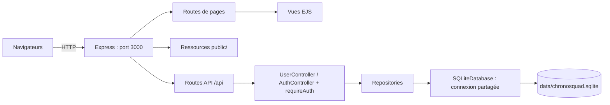
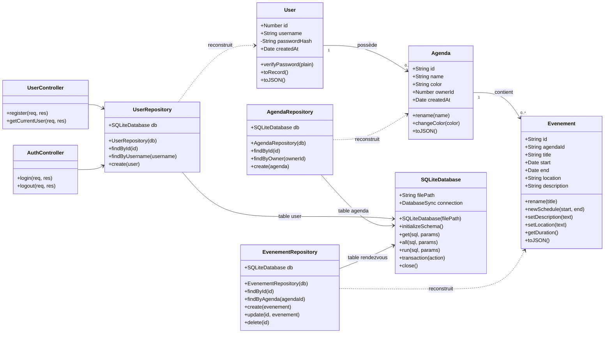

# Sprint 0 : Conception

## 1. Architecture générale

Un serveur unique Node.js / Express sur le port 3000 :
- rend les pages EJS de `views/` et sert les ressources de `public/` ;
- expose une API JSON sous `/api` ;
- initialise SQLite avant d'accepter les requêtes ;
- conserve les données dans `data/chronosquad.sqlite`.

SQLite est embarqué dans Node.js : aucun serveur SQL séparé, XAMPP ou phpMyAdmin n'est nécessaire. Les navigateurs communiquent avec Express, jamais directement avec le fichier SQLite.



**État actuel :** les pages, Express, SQLite, les repositories et l'authentification sont opérationnels. L'inscription, la connexion, l'utilisateur courant et la déconnexion sont implémentés, ainsi que `GET /api/health` et `GET /api/test/user-agenda`. Les contrôleurs d'agendas et de rendez-vous restent à réaliser. Voir [le guide d'authentification](authentification.md) et la page temporaire `/test/auth`.

## 2. Choix techniques

| Besoin | Choix | Justification |
|--------|-------|---------------|
| Serveur HTTP | Express | Pages et API sur le même serveur |
| Vues | EJS | Génération HTML côté serveur |
| Persistance | SQLite via `node:sqlite` / `DatabaseSync` | SQL embarqué, sans installation d'un service externe |
| Runtime | Node.js >= 22.13.0 ; Node.js 24 LTS conseillé | Disponibilité de `node:sqlite` sans option de lancement |
| Mots de passe | Argon2, utilisé par le modèle `User` | Le hash est conservé en base, exclu de `User.toJSON()` |
| Identifiants utilisateurs | Entiers auto-incrémentés par SQLite : 1, 2, 3… | Génération par la base, sans compteur JavaScript ; agendas et rendez-vous gardent leurs identifiants existants |
| Relations | Clés étrangères activées à chaque connexion | Empêche agendas et rendez-vous orphelins |
| Requêtes | Paramètres SQL `?` | Valeurs séparées du texte SQL |
| Transactions | `BEGIN IMMEDIATE / COMMIT / ROLLBACK` | Import atomique, écritures groupées cohérentes |
| Sessions | `express-session`, cookie HttpOnly et SameSite=Lax | Sessions de 8 heures en mémoire pour le sprint local ; reconnexion après redémarrage |

La connexion SQLite est synchrone et partagée dans le processus serveur. Les méthodes des repositories restent asynchrones pour conserver une interface utilisable avec `await`. Une transaction doit recevoir une fonction synchrone : effectuer les opérations asynchrones, comme le hachage, avant la transaction.

## 3. Diagramme de classes

Le diagramme représente le stockage et les contrôleurs d'authentification implémentés. La classe JavaScript `Evenement` représente un rendez-vous et correspond à la table **rendezvous**. Les contrôleurs d'agendas et de rendez-vous sont encore vides.

La version PlantUML se trouve dans [classes-sqlite.puml](classes-sqlite.puml).



Les repositories reçoivent la même connexion par défaut via `getDatabase()`. Les tests peuvent leur fournir une base distincte. Une recherche absente renvoie `null` ; une liste vide renvoie `[]`. `create()` renvoie l'objet créé, `update()` l'objet relu ou `null`, `delete()` un booléen. Les erreurs SQL sont propagées ; les futurs contrôleurs devront les traduire en réponses HTTP appropriées.

## 4. Schéma relationnel

Le SQL exécutable est dans `backend/storage/schema.sql`.

| Table | Colonnes |
|-------|----------|
| `user` | `id` INTEGER PK AUTOINCREMENT, `username` UNIQUE, `password_hash`, `created_at` |
| `agenda` | `id` PK, `name`, `color`, `owner_id` INTEGER FK vers `user.id`, `created_at` |
| `rendezvous` | `id` PK, `agenda_id` FK vers `agenda.id`, `title`, `start`, `end`, `location`, `description` |

Les identifiants utilisateurs et les références `owner_id` sont des INTEGER. Les identifiants d'agendas et de rendez-vous ainsi que les dates sont stockés en TEXT ; les repositories écrivent les dates en ISO 8601 UTC et reconstruisent les objets métier à la lecture. Les noms SQL en snake_case sont convertis en attributs JavaScript camelCase.

Les tables sont STRICT. Le schéma impose des noms/titres non vides, une couleur hexadécimale et une fin postérieure au début. Deux index accélèrent la recherche des agendas d'un utilisateur et des rendez-vous d'un agenda.

La suppression d'un utilisateur ayant des agendas, ou d'un agenda ayant des rendez-vous, est refusée (`ON DELETE RESTRICT`). Aucune suppression en cascade implicite.

Exemples :
```sql
SELECT * FROM agenda WHERE owner_id = ?;
SELECT * FROM rendezvous WHERE agenda_id = ? ORDER BY start, id;
SELECT rendezvous.*
FROM rendezvous
JOIN agenda ON agenda.id = rendezvous.agenda_id
WHERE agenda.owner_id = ?;
```

Les clés étrangères garantissent les relations. Les futurs contrôleurs devront encore vérifier que l'utilisateur connecté possède l'agenda concerné : une relation valide ne constitue pas une autorisation.

## 5. Initialisation et migration JSON

Au démarrage :
1. `SQLiteDatabase` ouvre/crée `data/chronosquad.sqlite`, active les clés étrangères et initialise les tables.
2. `initializeDatabase()` lit `PRAGMA user_version`. Une valeur supérieure ou égale à 1 signifie que l'initialisation et l'import sont terminés.
La version actuelle est 2. Une base de version 1 avec des identifiants utilisateurs TEXT est migrée automatiquement vers des entiers par `migrate-user-ids.sql`, avec conservation des comptes, hashes, agendas et rendez-vous. Les sessions antérieures demandent une reconnexion.

3. Si la valeur est 0 et les trois tables sont vides, les éventuels `users.json`, `agendas.json` et `evenements.json` sont lus. Les fichiers absents correspondent à des listes vides.
4. Les mots de passe d'exemple en clair sont hachés avec Argon2. Les hashes Argon2 existants sont conservés ; un autre format de hash entraîne un refus explicite.
5. Les utilisateurs, agendas, rendez-vous et le marqueur de version sont enregistrés dans une même transaction.
6. Express commence à écouter seulement après la réussite de l'initialisation.

Un JSON invalide, une relation inexistante ou un doublon annule l'import et empêche le démarrage. Corriger les JSON puis relancer : aucun import partiel n'est conservé. Une base non initialisée contenant déjà des lignes est refusée pour éviter de mélanger les données.

Les fichiers JSON historiques restent intacts comme référence. Après l'import, seule SQLite fait autorité : modifier un JSON ne modifie plus l'application, et redémarrer ne restaure pas les données supprimées en base. La base générée est exclue de Git. Ne pas supprimer le fichier SQLite pour un simple redémarrage.

## 6. Lancement, vérification et suite du sprint

```bash
npm install
npm start
npm test
```

- `npm start` : initialise SQLite et démarre Express sur le port 3000.
- `npm run dev` : même lancement avec surveillance des sources.
- `npm run test:storage` : tests SQLite isolés, sans modifier la base de l'application.
- `npm run test:server` : tests HTTP / EJS.

Lors du premier lancement avec les exemples historiques : 3 utilisateurs, 3 agendas et 4 rendez-vous sont importés. Les mots de passe restent les mêmes, avec un stockage haché ; les utilisateurs reçoivent des identifiants entiers et les propriétaires des agendas sont adaptés.

Après cet import, `backend/storage/test-data.sql` insère également un utilisateur
de démonstration (nom `sqlite_demo`, identifiant entier attribué par SQLite) et son agenda (`test-agenda`).
Le fichier est exécuté dans une transaction à chaque démarrage ; les identifiants
existants ne sont pas remplacés et aucun doublon n'est créé. Si ces données de
démonstration sont supprimées, elles sont recréées au prochain démarrage.
Les données JSON historiques restent importées une seule fois.

Ouvrir **http://localhost:3000/api/test/user-agenda** pour lire ces deux objets
depuis SQLite sous la forme `{ "user": {...}, "agenda": {...} }`.
Le mot de passe et son hash ne sont jamais renvoyés. Cette route ne réalise
aucune connexion et n'affiche pas les utilisateurs réels de l'application.

Les routes d'authentification correspondent au front existant : `POST /api/users`, `GET /api/users/me`, `POST /api/auth/login` et `POST /api/auth/logout`. La prochaine étape métier sera d'implémenter les contrôleurs d'agendas et de rendez-vous et de protéger leurs routes avec `requireAuth`. Le nom SQL `rendezvous` n'impose aucun renommage des URL `/api/evenements` du front.

Documentation officielle : [SQLite dans Node.js](https://nodejs.org/api/sqlite.html).
