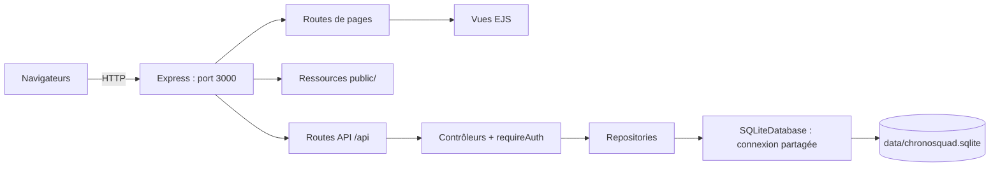
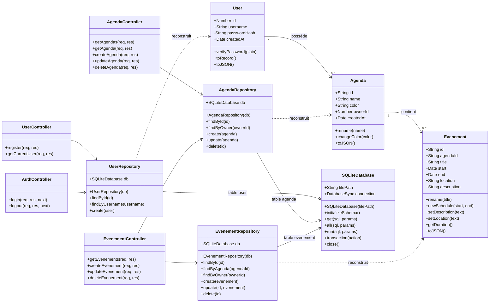

# Sprint 0 : Conception

## 1. Architecture générale

Un serveur unique Node.js / Express sur le port 3000 :

- rend les pages EJS de `views/` et sert les ressources de `public/` ;
- expose une API JSON sous `/api` ;
- initialise SQLite avant d'accepter les requêtes ;
- conserve les données dans `data/chronosquad.sqlite`.

SQLite est embarqué dans Node.js : aucun serveur SQL séparé, XAMPP ou phpMyAdmin n'est nécessaire. Les navigateurs communiquent avec Express, jamais directement avec le fichier SQLite.



**État actuel :** le front est raccordé à l'inscription, à la connexion, à la consultation de l'utilisateur courant et à la déconnexion. Les agendas et les événements peuvent être consultés, créés, modifiés et supprimés. Les routes métier exigent une session et vérifient le propriétaire des données.

Les pages principales sont `/` (connexion), `/register` (inscription) et `/agendas` (calendrier). Le front charge les données du calendrier depuis l'API. La page temporaire `/test/auth` existe encore pour simuler l'authentification sans mise en forme.

## 2. Choix techniques

| Besoin | Choix | Justification |
|--------|-------|---------------|
| Serveur HTTP | Express | Pages et API sur le même serveur |
| Vues | EJS | Génération HTML côté serveur |
| Persistance | SQLite via `node:sqlite` / `DatabaseSync` | SQL embarqué, sans installation d'un service externe |
| Runtime | Node.js >= 22.13.0 ; Node.js 24 LTS conseillé | Disponibilité de `node:sqlite` sans option de lancement |
| Mots de passe | Argon2, utilisé par le modèle `User` | Le hash est conservé en base, exclu de `User.toJSON()` |
| Identifiants utilisateurs | Entiers auto-incrémentés par SQLite : 1, 2, 3… | Génération par la base, sans compteur JavaScript ; agendas et événements gardent leurs identifiants existants |
| Relations | Clés étrangères activées à chaque connexion | Empêche agendas et événements orphelins |
| Requêtes | Paramètres SQL `?` | Valeurs séparées du texte SQL |
| Transactions | `BEGIN IMMEDIATE / COMMIT / ROLLBACK` | Initialisation, création des identifiants et suppression d'un agenda avec ses événements sans écriture partielle |
| Sessions | `express-session`, cookie HttpOnly et SameSite=Lax | Sessions de 8 heures en mémoire pour le sprint local ; reconnexion après redémarrage |

La connexion SQLite est synchrone et partagée dans le processus serveur. Les méthodes des repositories restent asynchrones pour conserver une interface utilisable avec `await`. Une transaction doit recevoir une fonction synchrone : effectuer les opérations asynchrones, comme le hachage, avant la transaction.

## 3. Diagramme de classes

Le diagramme représente le stockage et les contrôleurs implémentés. La classe JavaScript `Evenement` représente un événement et correspond à la table **evenement**.



Les repositories reçoivent la même connexion par défaut via `getDatabase()`. Les contrôleurs utilisent la connexion placée dans `app.locals.database` au démarrage ; les tests peuvent fournir une base distincte. Une recherche absente renvoie `null` ; une liste vide renvoie `[]`. `create()` renvoie l'objet créé, `update()` l'objet relu ou `null`, `delete()` un booléen. Les contrôleurs valident les données et les droits d'accès. Les erreurs non traitées sont transmises au middleware `errorHandler`.

## 4. Schéma relationnel

Le SQL exécutable est dans `backend/storage/schema.sql`.

| Table | Colonnes |
|-------|----------|
| `user` | `id` INTEGER PK AUTOINCREMENT, `username` UNIQUE, `password_hash`, `created_at` |
| `agenda` | `id` PK, `name`, `color`, `owner_id` INTEGER FK vers `user.id`, `created_at` |
| `evenement` | `id` PK, `agenda_id` FK vers `agenda.id`, `title`, `start`, `end`, `location`, `description` |

Les identifiants utilisateurs et les références `owner_id` sont des INTEGER. Les identifiants d'agendas et d'événements ainsi que les dates sont stockés en TEXT ; les repositories écrivent les dates en ISO 8601 UTC et reconstruisent les objets métier à la lecture. Les noms SQL en snake_case sont convertis en attributs JavaScript camelCase.

Les tables sont STRICT. Le schéma impose des noms/titres non vides, une couleur hexadécimale et une fin postérieure au début. Deux index accélèrent la recherche des agendas d'un utilisateur et des événements d'un agenda.

Les clés étrangères utilisent `ON DELETE RESTRICT` : SQLite refuse de supprimer directement un agenda qui contient encore des événements. La suppression depuis l'application reste possible : `AgendaRepository.delete()` supprime d'abord les événements, puis l'agenda, dans une même transaction. En cas d'erreur, les deux opérations sont annulées. La suppression d'un utilisateur ayant des agendas reste refusée par SQLite ; aucune route de suppression de compte n'est exposée.

Exemples :
```sql
SELECT * FROM agenda WHERE owner_id = ?;
SELECT * FROM evenement WHERE agenda_id = ? ORDER BY start, id;
SELECT evenement.*
FROM evenement
JOIN agenda ON agenda.id = evenement.agenda_id
WHERE agenda.owner_id = ?;
```

Les clés étrangères garantissent les relations. Les contrôleurs vérifient aussi que l'utilisateur connecté possède l'agenda concerné : une relation valide ne constitue pas une autorisation. Un événement peut être déplacé uniquement vers un autre agenda du même utilisateur.

## 5. Initialisation et données persistées

Au démarrage :

1. `SQLiteDatabase` ouvre ou crée `data/chronosquad.sqlite`, active les clés étrangères, effectue les migrations nécessaires et initialise les tables.
2. `initializeDatabase()` vérifie `PRAGMA user_version`. Une base déjà initialisée conserve ses données. Une base nouvelle est initialisée une seule fois.
3. `seedTestData()` exécute encore `backend/storage/test-data.sql` : un compte `sqlite_demo` et son agenda `test-agenda` sont ajoutés s'ils n'existent pas. Cette insertion ne dépend pas d'une route de démonstration. Si ces lignes sont supprimées, elles sont recréées au prochain démarrage.
4. La connexion est placée dans `app.locals.database`, puis Express écoute sur le port 3000.

La version actuelle du schéma est 3. Les migrations conservent les comptes, leurs hashes et les relations avec les agendas et les événements des anciennes bases.

Les anciens fichiers `users.json`, `agendas.json` et `evenements.json` ont été supprimés du projet. Le code d'import historique existe encore : lors de l'initialisation d'une base nouvelle, les fichiers absents correspondent à des listes vides. Ils ne sont donc pas nécessaires au fonctionnement. Si des fichiers historiques sont fournis, leur import reste transactionnel et les mots de passe en clair sont hachés.

Toutes les données utilisées par l'application sont enregistrées dans SQLite. La base locale est exclue de Git. Il faut conserver `data/chronosquad.sqlite` pour retrouver les comptes, agendas et événements après un redémarrage. Les sessions sont en mémoire : il faut se reconnecter après l'arrêt du serveur.

## 6. Lancement et routes disponibles

```bash
npm install
npm start
npm test
```

- `npm start` : initialise SQLite et démarre Express sur le port 3000.
- `npm run dev` : même lancement avec surveillance des sources.
- `npm run test:storage` : tests SQLite isolés, sans modifier la base de l'application.
- `npm run test:server` : tests HTTP / EJS.
- `npm run test:auth` : tests de l'inscription, de la connexion et des sessions.

Le serveur écoute sur `0.0.0.0:3000`. Sur le PC serveur, ouvrir `http://localhost:3000`. Depuis un autre PC du réseau local, utiliser `http://<adresse-ip-du-serveur>:3000`, à condition que le pare-feu autorise la connexion. Pour arrêter le serveur lancé dans le terminal, utiliser `Ctrl+C`. Pendant le développement, `npm run dev` recharge le serveur après une modification du code.

`GET /api/health` renvoie `{ "status": "ok" }` pour vérifier que le serveur répond.

Un ancien test dans `ServerTest.js` attend encore une route de démonstration supprimée. Ce test reste à adapter ; son échec ne signifie pas que les routes métier sont indisponibles.

Les routes d'authentification correspondent au front existant : `POST /api/users`, `GET /api/users/me`, `POST /api/auth/login` et `POST /api/auth/logout`.

Les raccordements métier actuels sont :

| Méthode | URL | Réponse |
|---------|-----|---------|
| GET | `/api/agendas` | Tableau des agendas de l'utilisateur |
| GET | `/api/agendas/:id` | Agenda de l'utilisateur ou 404 |
| POST | `/api/agendas` | 201 agenda créé avec `{ name, color? }` |
| PUT | `/api/agendas/:id` | 200 agenda modifié avec `{ name, color }` |
| DELETE | `/api/agendas/:id` | 204 sans contenu ; supprime aussi les événements de l'agenda |
| GET | `/api/evenements` | Tableau des événements des agendas de l'utilisateur |
| POST | `/api/agendas/:agendaId/evenements` | 201 événement créé avec `{ title, start, end, location?, description? }` |
| PUT | `/api/evenements/:id` | 200 événement modifié avec `{ title, start, end, agendaId?, location?, description? }` |
| DELETE | `/api/evenements/:id` | 204 sans contenu |

Ces routes exigent une session (401 sinon). Le propriétaire vient de `req.user.id`,
jamais du corps envoyé par le client. Consulter un agenda d'un autre utilisateur
ou y créer un événement renvoie 404. Les champs invalides renvoient 400.
Les nouveaux identifiants d'agendas et d'événements sont des chiffres stockés
comme chaînes, compatibles avec les IDs déjà utilisés dans le front.
Les générations d'identifiants et insertions sont groupées dans une transaction SQLite.
Le nom SQL `evenement` n'impose aucun renommage des URL `/api/evenements` du front.
Les boutons du front utilisent ces routes pour modifier et supprimer les agendas et les événements. Après une réponse réussie, les listes et le calendrier sont actualisés. Les suppressions demandent une confirmation dans l'interface.

Documentation officielle : [SQLite dans Node.js](https://nodejs.org/api/sqlite.html).
