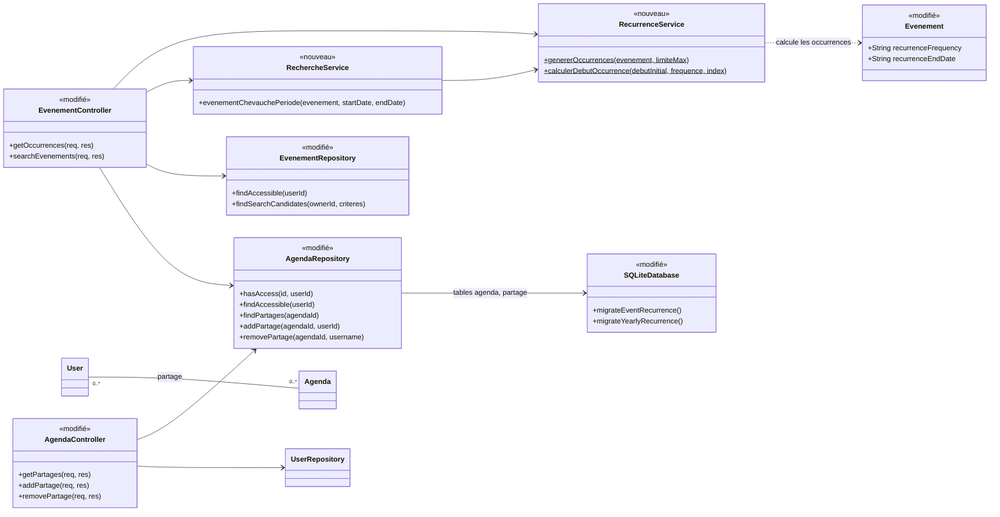
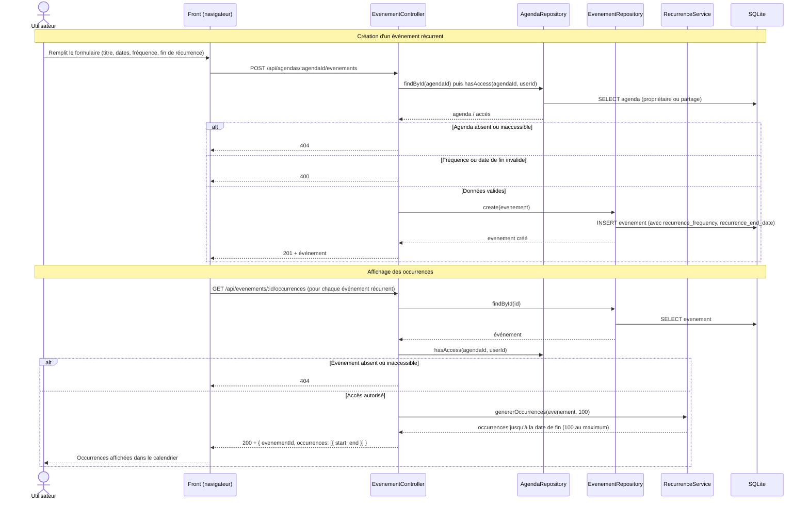
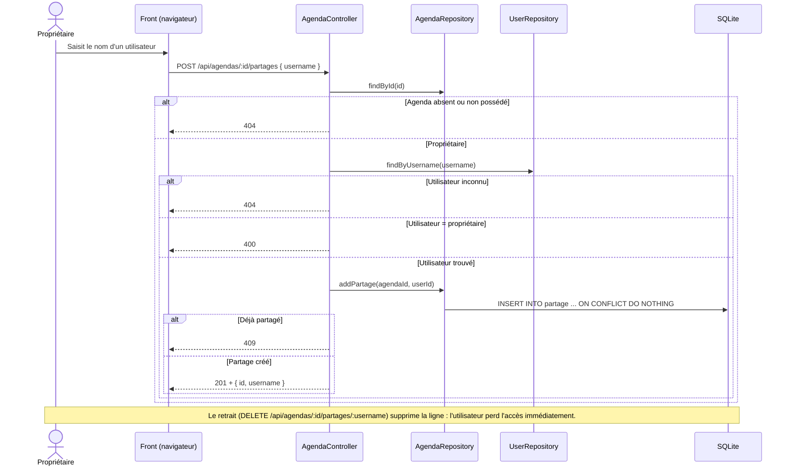
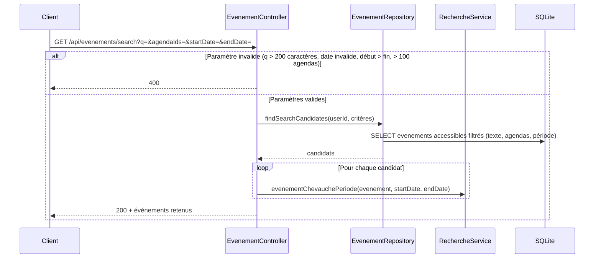

# Sprint 1 : Conception

Ce document décrit uniquement ce qui a été ajouté ou modifié pendant le sprint 1. L'architecture générale (Express, EJS, SQLite embarqué), les choix techniques de base, l'authentification, le schéma initial (`user`, `agenda`, `evenement`), l'initialisation de la base et le lancement du projet sont décrits dans [la conception du sprint 0](../sprint0/conception.md) et restent valables.

## 1. Périmètre du sprint

Objectif : passer d'une gestion simple des agendas à une gestion avancée — vue consolidée de plusieurs agendas, rendez-vous récurrents, recherche et partage d'agendas.

| User story | Back-end | Front-end |
|------------|----------|-----------|
| US-08 Visualisation | Aucune modification : `GET /api/agendas` et `GET /api/evenements` renvoient déjà toutes les données nécessaires | Sélection de plusieurs agendas ; le calendrier affiche ensemble les rendez-vous des agendas sélectionnés |
| US-09 Récurrence | Colonnes de récurrence (migrations 004 et 005), validation dans `Evenement`, service `RecurrenceService`, route des occurrences | Champs « récurrence » et « fin de récurrence » dans le formulaire ; affichage des occurrences dans le calendrier |
| US-10 Recherche | `EvenementRepository.findSearchCandidates()`, service `RechercheService`, route `GET /api/evenements/search` | Barre de recherche et filtres (titre, date, agenda, lieu) avec liste de résultats ; agenda et date filtrés via la route de recherche |
| US-11 / US-12 Partage | Table `partage`, méthodes de partage dans `AgendaRepository`, routes `/api/agendas/:id/partages`, contrôle d'accès `hasAccess()` | Panneau de partage : ajout d'un utilisateur, liste des partages, retrait d'un partage ; affichage du propriétaire des agendas partagés |

## 2. Choix techniques ajoutés

| Besoin | Choix | Justification |
|--------|-------|---------------|
| Calcul des occurrences | Service `RecurrenceService` | Logique séparée du modèle `Evenement` : modèle plus léger, calcul testable isolément |
| Stockage de la récurrence | Deux colonnes dans `evenement` (fréquence + date de fin) | Une seule ligne par rendez-vous ; les occurrences sont calculées, jamais stockées |
| Dates des occurrences | Chaque occurrence est calculée à partir de la date initiale, en UTC | Pas de dérive cumulée ; un 31 du mois devient le dernier jour des mois plus courts, un 29 février devient le 28 les années non bissextiles |
| Recherche | Filtrage SQL des candidats, puis vérification des occurrences en JavaScript | SQL filtre le texte, les agendas et les dates simples ; les récurrences sont vérifiées occurrence par occurrence |
| Partage | Table d'association `partage` (agenda, utilisateur) | Relation plusieurs-à-plusieurs, sans dupliquer les agendas |
| Droits d'accès | `AgendaRepository.hasAccess(id, userId)` : propriétaire **ou** partage | Une seule règle réutilisée par les contrôleurs d'agendas et d'événements |
| Évolution du schéma | Fichiers de migration SQL dans `backend/storage/migrations/` | Historique clair des changements, appliqué automatiquement sur la base existante de chaque membre sans perte de données |

## 3. Diagramme de classes : éléments ajoutés ou modifiés

Seuls les membres nouveaux sont détaillés ; les classes inchangées depuis le sprint 0 (`User`, `UserController`, `AuthController`) n'apparaissent que si elles participent à une nouvelle relation.



Le constructeur de `Evenement` reçoit désormais `recurrenceFrequency` et `recurrenceEndDate` et les valide : fréquence `daily`, `weekly`, `monthly` ou `yearly` ; date de fin au format `AAAA-MM-JJ`, non antérieure au jour de début ; une date de fin sans fréquence est refusée. Les deux attributs apparaissent dans `toJSON()`.

Les méthodes `findByOwner()` existent toujours, mais les contrôleurs utilisent maintenant `findAccessible()` et `hasAccess()` pour inclure les agendas partagés.

## 4. Diagrammes de séquence

### Récurrence (US-09)



### Partage (US-11 / US-12)



### Recherche (US-10)



## 5. Modifications de la base de données

### Changements du schéma

| Changement | Fichier | Détail |
|------------|---------|--------|
| Nouvelle table `partage` | `schema.sql` | `agenda_id` TEXT FK vers `agenda.id` `ON DELETE CASCADE`, `user_id` INTEGER FK vers `user.id` `ON DELETE CASCADE`, PK (`agenda_id`, `user_id`), table STRICT |
| Nouvel index `partage_user_idx` | `schema.sql` | Sur `partage(user_id)` : retrouve vite les agendas partagés avec un utilisateur |
| Colonnes de récurrence | `migrations/004-event-recurrence.sql` | `recurrence_frequency` TEXT (`NULL`, `daily`, `weekly`, `monthly`) et `recurrence_end_date` TEXT (`NULL` ou date `AAAA-MM-JJ` valide) ajoutées à `evenement` |
| Récurrence annuelle | `migrations/005-yearly-recurrence.sql` | Recréation de `evenement` (copie des données, suppression, renommage, recréation de `evenement_agenda_start_idx`) pour ajouter `yearly` à la contrainte CHECK |
| Rangement | `migrations/migrate-user-ids.sql` | Le script de conversion des identifiants utilisateurs du sprint 0 a été déplacé dans `migrations/`, sans modification |

Structure finale de `evenement` : `id`, `agenda_id`, `title`, `start`, `end`, `location`, `description`, `recurrence_frequency`, `recurrence_end_date`.

Le schéma ne lie pas les deux colonnes de récurrence entre elles ; c'est le modèle `Evenement` qui refuse une date de fin sans fréquence. Un rendez-vous ponctuel laisse les deux colonnes à `NULL`.

Grâce à `ON DELETE CASCADE`, les partages d'un agenda supprimé disparaissent automatiquement : `AgendaRepository.delete()` continue de supprimer uniquement les événements puis l'agenda, dans une même transaction.

### Application des migrations

`SQLiteDatabase` applique désormais, après `schema.sql` :

1. `migrateEventRecurrence()` : exécute uniquement les `ADD COLUMN` de la migration 004 dont la colonne est absente ;
2. `migrateYearlyRecurrence()` : si la définition de `evenement` ne contient pas encore `'yearly'`, exécute la migration 005 dans une transaction, clés étrangères désactivées, puis vérifie `PRAGMA foreign_key_check`.

`PRAGMA user_version` reste à 3 : ces migrations sont détectées à partir de la structure de la table `evenement`, pas d'un numéro de version. Les bases existantes des membres de l'équipe sont mises à jour au premier démarrage, sans perte de données.

`data/chronosquad.sqlite` n'est plus suivi par Git : le fichier a été retiré du dépôt (`git rm --cached`) et `.gitignore` exclut le dossier `data/`. Chaque membre garde sa propre base locale, créée ou mise à jour automatiquement au démarrage.

### Nouvelles requêtes

Accès aux agendas possédés ou partagés (`hasAccess`, `findAccessible`) :

```sql
SELECT evenement.*
FROM evenement
JOIN agenda ON agenda.id = evenement.agenda_id
WHERE agenda.owner_id = ? OR EXISTS (
    SELECT 1 FROM partage
    WHERE partage.agenda_id = agenda.id AND partage.user_id = ?
)
ORDER BY evenement.start, evenement.id;
```

Recherche (`findSearchCandidates`) : la même condition d'accès, complétée selon les critères fournis par :

- texte : `instr(lower(title|description|location), lower(?)) > 0` sur l'un des trois champs ;
- agendas : `evenement.agenda_id IN (?, ?, …)` ;
- période : `evenement.end > début` (ou événement récurrent) et `evenement.start < lendemain de la fin`. La fin de période est inclusive.

Les candidats récurrents sont ensuite filtrés par `RechercheService`, qui vérifie qu'au moins une occurrence chevauche la période.

## 6. Règles métier ajoutées

- **Récurrence :** sans date de fin, `RecurrenceService` ne renvoie que l'occurrence initiale. Avec une date de fin (incluse), il renvoie les occurrences jusqu'à cette date, 100 au maximum par appel.
- **Droits d'accès :** un utilisateur à qui un agenda est partagé peut consulter et modifier l'agenda (nom, couleur) et créer, modifier ou supprimer ses événements. Seul le propriétaire peut supprimer l'agenda et gérer ses partages. Sans accès, la réponse est 404, comme au sprint 0.
- **Déplacement d'un événement :** autorisé vers tout agenda accessible à l'utilisateur (possédé ou partagé).

## 7. Routes API ajoutées ou modifiées

Nouvelles routes (session obligatoire, 401 sinon) :

| Méthode | URL | Réponse |
|---------|-----|---------|
| GET | `/api/agendas/:id/partages` | Utilisateurs avec qui l'agenda est partagé (propriétaire uniquement) |
| POST | `/api/agendas/:id/partages` | 201 `{ id, username }` avec `{ username }` ; 400 soi-même, 404 utilisateur inconnu, 409 déjà partagé |
| DELETE | `/api/agendas/:id/partages/:username` | 204 ; 404 partage absent |
| GET | `/api/evenements/:id/occurrences` | `{ evenementId, occurrences: [{ start, end }] }` |
| GET | `/api/evenements/search` | Événements accessibles filtrés par `q`, `agendaIds` (`a1,a2` ou paramètre répété), `startDate`, `endDate` (`AAAA-MM-JJ`) |

Routes existantes modifiées :

| Méthode | URL | Changement |
|---------|-----|------------|
| GET | `/api/agendas` | Inclut les agendas partagés ; chaque agenda porte `ownerName` et `sharedWith` (liste vide si l'utilisateur n'en est pas propriétaire) |
| GET / PUT | `/api/agendas/:id` | Accessible aussi aux utilisateurs avec qui l'agenda est partagé |
| GET | `/api/evenements` | Inclut les événements des agendas partagés |
| POST | `/api/agendas/:agendaId/evenements` | Accepte `recurrenceFrequency?` et `recurrenceEndDate?` ; possible dans un agenda partagé |
| PUT / DELETE | `/api/evenements/:id` | `PUT` accepte `recurrenceFrequency?` et `recurrenceEndDate?` ; les deux routes sont possibles dans un agenda partagé |

Le client `public/js/api.js` expose les nouvelles fonctions `getPartages`, `addPartage`, `removePartage`, `getOccurrences` et `searchEvenements`.

Dans l'interface, la recherche combine le serveur et le navigateur :

- quand un agenda ou une date est choisi, le front appelle `GET /api/evenements/search` avec `agendaIds` et une période élargie d'un jour de chaque côté (le serveur raisonne en jours UTC, l'interface en jours locaux) ; le serveur renvoie les événements, récurrents compris, qui ont une occurrence dans la période ;
- les occurrences affichées dans le calendrier sont ensuite limitées à ces événements, puis filtrées localement par texte (recherche rapide, titre, lieu) et par jour local exact ;
- le texte n'est pas envoyé au serveur : la comparaison locale ignore les accents et inclut le nom de l'agenda, alors que `lower()` de SQLite ne traite que les lettres ASCII ;
- si le serveur ne répond pas, le filtrage local seul est appliqué ; une réponse arrivée après une recherche plus récente est ignorée.

## 8. Tests ajoutés

Tous les tests utilisent `node:test` et une base SQLite en mémoire : ils ne modifient jamais `data/chronosquad.sqlite`.

| Fichier | Contenu |
|---------|---------|
| `EvenementTest.js` | Récurrence dans le modèle : `toJSON()`, refus d'une fréquence inconnue, d'une date de fin mal formée, invalide, antérieure au début ou sans fréquence ; occurrences hebdomadaires |
| `test-recurrence-service.js` | Occurrences quotidiennes, hebdomadaires, mensuelles (31 janvier) et annuelles (29 février), limite et cas d'erreur |
| `test-recurrence-integration.js` | Enregistrement et relecture d'un événement annuel, calcul de ses 3 occurrences ; contrainte CHECK sur la fréquence |
| `RechercheRepositoryTest.js` | Requête SQL des candidats : texte, agendas, période, isolation des utilisateurs |
| `RechercheControllerTest.js` | Validation des paramètres (400), filtrage des occurrences, fins de mois et années bissextiles |
| `RechercheRoutesTest.js` | Route `/api/evenements/search` de bout en bout, dont le refus sans session (401) |
| `SQLiteTest.js` (modifié) | Liste des tables mise à jour avec `partage` |

Ils sont inclus dans `npm test` et disposent de scripts dédiés :

- `npm run test:recurrence` : `EvenementTest.js`, `test-recurrence-service.js`, `test-recurrence-integration.js` ;
- `npm run test:recherche` : les trois fichiers `Recherche*Test.js`.
Documentation officielle : [SQLite dans Node.js](https://nodejs.org/api/sqlite.html).
